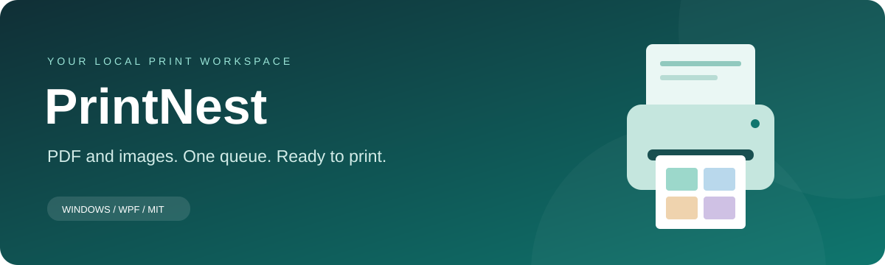
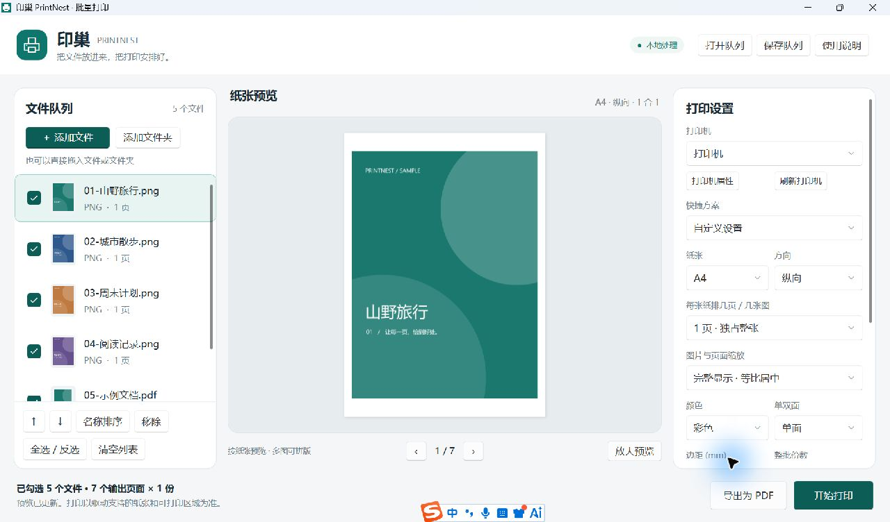
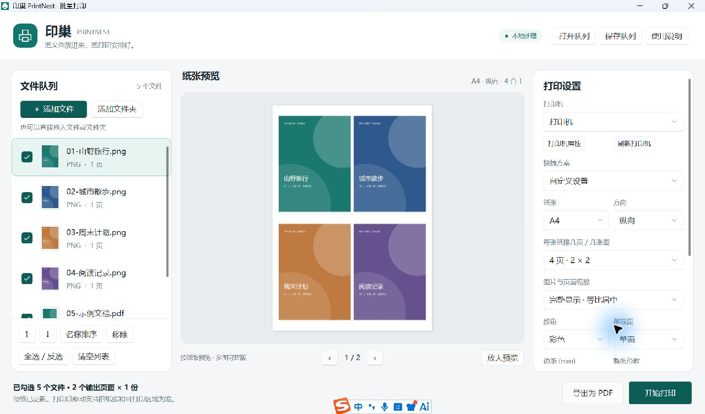

<div align="center">

# 印巢 · PrintNest

**把 PDF 和图片放进一个队列，让每一页恰到好处。**

Windows 原生批量打印工具 · 本地处理 · 无需 Python、WPS 或 Office


[](LICENSE.txt)

[下载便携版](https://github.com/H-Koala/PrintNest/releases) · [界面预览](#界面预览) · [快速开始](#快速开始) · [从源码构建](#从源码构建) · [反馈问题](https://github.com/H-Koala/PrintNest/issues) · [参与贡献](CONTRIBUTING.md)

</div>

## 为什么做印巢

打印一份 PDF 很简单；把多个 PDF、扫描件和图片按顺序、页码、份数排好再打印，却往往需要反复打开文件和调整设置。

印巢把文件队列、纸张预览和打印设置放在同一个窗口中：先整理，再预览，最后一次提交。适合日常资料、报销附件、学习材料和图片的集中打印。

目前项目采用 MIT 许可证，现有功能无需账号、会员或激活码。文件在本机处理，不上传到服务器。

> **项目状态：早期版本 1.0.1。** 已提供自动化功能自检，但尚未完成实体打印机兼容性验证。首次使用某台打印机时，建议先少量试打。

## 界面预览

以下为 **PrintNest 1.0.1 在 Windows 上的实际运行截图**，使用项目自带的示例图片与 PDF。

### 主界面：文件队列、纸张预览与打印设置

左侧集中管理 PDF 和图片，中间查看纸张效果，右侧调整输出设置。导入后可逐个勾选文件，并在打印前确认整批输出数量。



### 四页拼版：一张纸安排多张图片

将“每张纸排几页 / 几张图”设为 **4 页 · 2 × 2**，预览随设置更新。同一队列中的 4 张图片与 3 页 PDF，按顺序排成 2 个输出页面；下图展示第 1 页。



## 功能概览

| 你想做的事 | 印巢提供的能力 |
| --- | --- |
| 一次加入多种文件 | PDF、JPEG、PNG、BMP、TIFF、GIF 混合队列；拖放文件、递归添加文件夹 |
| 整理打印顺序 | 文件名自然排序、路径去重、手动上移/下移、勾选参与输出的文件 |
| 只打印需要的内容 | 每个文件独立设置页码范围、份数和旋转角度 |
| 节省纸张 | 每张纸 1 / 2 / 4 / 6 / 9 页，PDF 页面与图片连续混排 |
| 控制图片排版 | 完整显示、等比铺满裁切、拉伸；处理 JPEG EXIF 方向 |
| 提前检查结果 | 缩略图、分页纸张预览、输出数量确认 |
| 设置输出 | A4、A5、Letter、4×6 英寸；横竖方向、边距、灰度、150 / 300 / 600 DPI |
| 打印或保存 | 原生 Windows GDI 打印、驱动支持时双面打印、导出合成 PDF |
| 下次接着使用 | 保存/恢复文件队列，记住常用输出设置 |

### 文件格式

| 格式 | 支持情况 |
| --- | --- |
| PDF | 多页；加密文件需先解锁 |
| JPG / JPEG、PNG、BMP | 支持 |
| TIF / TIFF | 支持多帧 |
| GIF | 仅首帧，不输出动画 |
| Word、Excel、HEIC、WebP、SVG、XPS | 暂不直接支持，可先转换为 PDF 或支持的图片格式 |

## 快速开始

**系统要求：Windows 10 2004（Build 19041）或更新版本 / Windows 11，x64。**

前往 [Releases](https://github.com/H-Koala/PrintNest/releases)，下载 `PrintNest-版本号-win-x64.zip`，完整解压后运行 `PrintNest.exe`。请保留同目录的许可证文件。自包含便携包无需另装 .NET；GitHub 的 **Code → Download ZIP** 下载的是源码，需要自行构建。

1. **加入文件**：点击“添加文件”或“添加文件夹”，也可以拖入 PDF 和图片。
2. **整理队列**：勾选文件，调整顺序；选中文件后设置该文件的页码、份数或旋转。
3. **设置纸张**：选择打印机、纸张、方向、每张纸页数、缩放和边距。
4. **检查预览**：翻页检查裁切、排版和总量。
5. **输出**：点击“导出为 PDF”，或点击“开始打印”并确认数量。

| 快捷键 | 操作 |
| --- | --- |
| `Ctrl + O` | 添加文件 |
| `Ctrl + P` | 打印 |
| `Delete` | 从队列移除文件，不删除源文件 |

### 页码、份数和拼版如何配合

页码从 **1** 开始，支持 `1-3,5`。程序先按队列顺序展开选定页面与单文件份数，再按每张纸页数连续拼版；整批份数复制整套输出。

例如：A 是两页 PDF，打印两份；B 是一张图片，打印一份。逻辑页面顺序为：

```text
A 第 1 页 → A 第 2 页 → A 第 1 页 → A 第 2 页 → B 图片
```

选择“2 合 1”后，一整套产生 3 个输出页面。预览显示一整套；整批份数决定打印多少套。

**拼版会跨文件边界**，双面时不同文件也可能位于同一张纸的正反面。当前不提供“每个文件强制从新纸张开始”的隔页功能。

## 常见问题

**导出的 PDF 可以复制文字吗？**  
当前打印和导出均采用所选 DPI 栅格化。导出 PDF 不保留可选择文本、矢量内容、链接或表单。高 DPI 会增加处理时间、临时空间和输出体积。

**为什么实际打印边距与预览不同？**  
打印机存在硬件不可打印区域；纸张、纸盒、无边距和双面能力由驱动决定。建议从 8 mm 边距开始试打。不支持的纸张或双面设置可能报错。

**“打印机属性”里的“打印”会直接出纸吗？**  
不会。该入口使用 Windows 系统打印对话框，此处的“打印”仅应用属性。真正提交任务需要回到主窗口点击“开始打印”。纸张、颜色、方向、份数、双面以主窗口设置为准，纸盒等其他属性保留驱动设置。

**点击停止后为什么打印机还在出纸？**  
停止可以中断准备、导出及后续提交。已进入 Windows 打印队列或打印机缓存的页面，可能还需在系统打印队列或设备端取消。

**保存队列后能把源文件删掉吗？**  
不能。队列记录源文件的绝对路径和设置，不内嵌文件。移动、改名或删除源文件后，需要重新添加。

**文件和设置保存在什么地方？**  
文件仅在本机处理；设置保存在 `%LOCALAPPDATA%\PrintNest\settings.json`，输出准备使用系统临时目录。当前无账号、订阅、遥测或自动更新。提交问题时请勿附带真实票据、个人资料或敏感文件路径。

**支持 macOS、Linux 或 ARM64 吗？**  
当前面向 Windows x64；其他系统和架构未作为发布目标验证。现有便携程序尚未进行数字签名。

## 从源码构建

需要 Windows 和 [.NET 10 SDK](https://dotnet.microsoft.com/download/dotnet/10.0)。仅使用便携版不需要 SDK。

在包含 `PrintNest.csproj` 的目录打开 PowerShell：

```powershell
dotnet restore PrintNest.csproj
dotnet build PrintNest.csproj -c Release --no-restore
dotnet run --project PrintNest.csproj -c Release
```

发布 Windows x64 自包含单文件程序：

```powershell
dotnet publish PrintNest.csproj -c Release -r win-x64 --self-contained true -p:PublishSingleFile=true -p:IncludeNativeLibrariesForSelfExtract=true -p:EnableCompressionInSingleFile=true -p:DebugType=None -o dist
```

分发时保留 `dist` 中的 `licenses` 目录和项目许可证。首次启动会在系统临时目录解压随附的本机库。

### 功能自检

使用一个新的测试目录运行：

```powershell
$testDir = Join-Path $env:TEMP ("PrintNest-test-" + [guid]::NewGuid().ToString("N"))
$process = Start-Process .\dist\PrintNest.exe -ArgumentList @('--self-test', $testDir) -Wait -PassThru
Get-Content (Join-Path $testDir 'test-results.txt')
if ($process.ExitCode -ne 0) { throw 'PrintNest self-test failed' }
```

自检生成示例图片与 PDF，覆盖页码校验、份数展开、混合拼版、横竖方向、旋转、缩放、PDF 导出回读、取消和原生 GDI 位图传输。**不会提交物理打印任务，也不能替代真实打印机测试。**

## 技术与代码结构

基于 C#、.NET 10 和 WPF；使用 WPF UI 构建 Fluent 风格界面、Windows.Data.Pdf 解码 PDF、PDFsharp 输出 PDF，以及 Windows GDI 提交打印任务。

```text
PrintNest/
├── MainWindow.xaml / .cs  # 界面、导入、设置和任务协调
├── Models.cs              # 队列模型、页码解析、设置保存
├── DocumentService.cs     # PDF / 图片解码与共用排版
├── OutputService.cs       # 导出、打印协调与页面缓存
├── GdiPrinter.cs          # 原生 Windows GDI 打印
├── SelfTest.cs            # 不出纸的功能自检
└── licenses/              # 第三方许可证与声明
```

## 参与贡献

欢迎报告问题、补充打印机兼容性结果和提交改进。请先阅读 [贡献指南](CONTRIBUTING.md)。报告打印问题时，请注明 Windows 版本、打印机型号、驱动、输出设置和复现步骤，并尽量提供脱敏的最小示例。

可能的后续方向包括打印方案预设、任务历史与补打、文件夹监控，以及更多设备兼容性验证；**这些是讨论方向，不是当前已实现功能或交付承诺。**

版本变化见 [CHANGELOG.md](CHANGELOG.md)。

## 致谢与许可证

- [WPF UI](https://github.com/lepoco/wpfui)：Fluent 风格 WPF 控件。
- [PDFsharp](https://github.com/empira/PDFsharp)：PDF 创建与输出。
- [.NET](https://github.com/dotnet/runtime) / [WPF](https://github.com/dotnet/wpf)：运行时和桌面界面基础。
- README 的组织方式参考 [PowerToys](https://github.com/microsoft/PowerToys) 和 WPF UI。

PrintNest 源码采用 [MIT License](LICENSE.txt)。第三方组件遵循各自许可证，详见 [licenses](licenses)。
